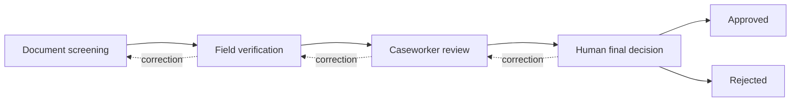
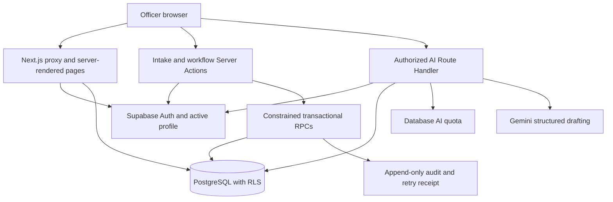

# ಸೇವಾಸಾಥಿ · SevaSathi

**Kannada-first income-certificate workspace for Karnataka revenue officers.**

SevaSathi brings document screening, field verification, caseworker review and a final human decision into one role-aware workspace. Gemini helps officers draft from saved case information while the database enforces the workflow and preserves its history.

**This is an independent demonstration prototype for the Kenpath Full Stack AI Engineer assignment, not an official government platform.** Officers and applications are fictional. Approval in this application does not issue a government certificate.

## Submission status and documentation

- Supplied deadline: **Monday, 2 November 2026**; no cutoff time was supplied.
- Actual configured GitHub remote: [Anamika-Singh1/SevaSathi](https://github.com/Anamika-Singh1/SevaSathi). Read-only Git access succeeded on 30 October; no branch references were returned at that check. See [Phase 7 verification](docs/PHASE_7_VERIFICATION.md) for final local commit/publication status.
- Deployed application URL: **not verified**. No Vercel deployment is claimed.
- Live Gemini SDK generation: **passed on 1 November 2026** for all four stages in Kannada and English using fictional data. Hosted authenticated endpoint generation remains unverified. See [AI verification](docs/AI_ASSISTANCE_VERIFICATION.md).
- Hosted setup: the user reports that the original nine SQL setup parts succeeded and twelve fictional applications are present. Hosted dashboard/login and the new intake UI remain unverified; see [safe recovery](docs/LOGIN_RECOVERY.md) and the additional migration below.
- [QA report](QA_REPORT.md) · [Deployment](docs/DEPLOYMENT.md) · [Five-minute demo](docs/EVALUATOR_DEMO.md) · [Impact plan](docs/IMPACT_MEASUREMENT.md) · [Final evaluation](docs/FINAL_EVALUATION.md) · [Submission email draft](docs/SUBMISSION_EMAIL.md).

## Problem statement and target officers

An income-certificate case passes through several officers. Scattered document gaps, verification observations, review remarks and correction requests make each handoff harder to understand. SevaSathi demonstrates a shared record with explicit responsibility, saved progress, outstanding issues and an ordered audit trail. It proposes a workflow improvement; it does not claim measured time savings.

Target users are the Nadakacheri operator, Village Accountant/Revenue Inspector undertaking field verification, caseworker and authorized signing officer. The prototype maps these responsibilities to four application roles; a demo account has no government authority.

## Selected service and official process reference

The selected service is the **Karnataka income certificate**. The [Tumakuru district administration's documented process](https://tumkur.nic.in/en/service/apply-for-income-certificate/) describes operator receipt, VA/RI physical verification, caseworker forwarding and a signing authority's approval or rejection. This reference informs the prototype's four stages.

SevaSathi supports officer-entered applications alongside seeded examples. Citizen self-service intake, payment, document printing, digital signing, certificate issuance and appeals are outside its scope. The three-item screening checklist and configurable targets are demonstration choices, not an authoritative document list or statutory service deadline.

## Workflow and responsibilities



| Stage / role | Human responsibilities | Handoff requirements |
| --- | --- | --- |
| Screening · `OPERATOR` | Record document receipts/notes; assign officers; request clarification | Required receipts, screening notes and valid downstream assignments |
| Field verification · `FIELD_OFFICER` | Record actual visit date, observations, evidence checks, verification status and questions | Prior screening, valid date, Verified status, all checks and resolved questions |
| Review · `CASEWORKER` | Review documents, income and submitted field report; record notes/issues | Submitted field report, evidence acknowledgements and resolved issues |
| Final decision · `APPROVING_OFFICER` | Review consolidated evidence; explicitly approve, reject or return | Prior manual sign-offs, confirmation and a reason for rejection/return |

**Save** persists incomplete work without advancing. **Return** records the reason, correction destination and resume destination. After correction, **Resume** sends work back to the requesting stage. Nested returns unwind in order and affected sign-offs must be renewed. Final decisions are locked. Legacy later-stage fixtures lack historical manual sign-offs and must return through the required stages before a decision.

## Features

- Provisioned officer login/logout, role queues and jurisdiction-scoped records.
- Operator **Add application** in the workspace header and dashboard/application list: enter applicant details, certificate service, application date, document receipts and optional notes. District/taluk come from the trusted profile.
- Six live dashboard metrics: pending, immediate attention, field pending, final review pending, overdue and recently processed.
- Name/reference/UUID search, combined village/stage/priority/overdue filters, sorting and pagination.
- Case overview, document checklist, field report, caseworker review, AI panel and full history.
- Draft/save recovery, stale-version warnings, discard/decision confirmation and safe lost-response retry.
- Transactional updates, version checks and request receipts for concurrent/duplicate submissions.
- Append-only audit records with actor snapshots, timestamps, reasons and before/after state.
- Responsive mobile cards/navigation, Kannada/English and contextual AI drafting.

Priority follows transparent demonstration rules using configured targets, stage age and unresolved actions. It is not an AI eligibility score.

## AI integration and human-in-the-loop decisions

The official `@google/genai` SDK runs on the server. `POST /api/applications/[id]/ai/[feature]` supports:

| Assistant | Saved context | Assistance |
| --- | --- | --- |
| `screening` | Purpose/income, receipt checklist, screening notes, saved case notes and clarification | Receipt completeness, gaps, inconsistencies, follow-up questions and editable clarification message |
| `field` | Case facts, screening, saved case notes, recorded visit, observations, checks/status and follow-up questions | Observation summary, structured field report, unverified information and editable report draft |
| `review` | Case facts, screening, field report, saved case notes, review issues and clarification | Evidence synthesis, missing information, inconsistencies, questions and editable review draft |
| `decision` | Consolidated evidence/notes and optional explicit human intent; recorded outcome on closed cases | Neutral summary, evidence, outstanding issues and editable decision note |

Each assistant requires the assigned role, correct stage and saved version. The server retrieves case data and notes through the caller's Supabase session and RLS; callers cannot replace them. Names, record/officer IDs, locations, storage paths, credentials, files and full audit logs are excluded as structured fields. Free-text notes can contain what an officer enters: use fictional data and review text before sending it to an external model. Records with more than 20 saved case notes or a projected context above 32,000 characters are refused rather than silently omitting evidence. The server rechecks authorization, version and the actual projected evidence after generation.

Every assistant returns validated JSON with `stage`, `language`, `summary`, `evidence`, `missingInformation`, `inconsistencies`, `followUpQuestions`, `unverifiedInformation`, `draftNote` and `limitations`. The four response stages are `DOCUMENT_SCREENING`, `FIELD_VERIFICATION`, `CASEWORKER_REVIEW` and `FINAL_DECISION`; existing database status values are preserved. A mismatched stage/language, extra fields, unsafe assertions or an oversized draft produce an error. Kannada validation checks every displayed section for Kannada text; this heuristic does not prove translation quality.

Prompts treat notes as untrusted data and forbid invented visits, authenticity claims and approval/rejection recommendations. Structured JSON receives independent schema/output validation. These controls do not eliminate hallucinations; officers must check suggestions against evidence.

**Generation, editing or copying cannot save an official note, advance a stage, approve or reject.** Officers deliberately verify manual evidence and submit the authorized action. The AI has no workflow mutation tools.

On an assigned case, save manual entries first and click **Generate AI Assistance**. Review the summary, evidence, gaps, questions and limitations; edit the draft and use **Copy draft**. Paste it into the appropriate workflow notes and explicitly save after review. **Regenerate** asks before replacing an edited draft; failed attempts retain it. Drafts are capped at 4,000 characters to fit the manual notes fields. Actual approval/rejection/return controls and their confirmation/reason requirements remain separate.

A shared database quota allows six attempts per officer per 60-second window. Provider calls have a 30-second timeout, explicit retries and sanitized failures. Access/version is checked again after generation. Missing configuration, rate limits, timeouts and unusable output leave manual processing available and preserve an existing edited draft after failed retry. The hosting route declares a 60-second function budget around provider work and database checks.

The default is `gemini-3.5-flash-lite`, configurable with `GEMINI_MODEL`. Check [Google's model documentation](https://ai.google.dev/gemini-api/docs/models/gemini-3.5-flash-lite) and verify access with the deployment's real key. The SDK uses structured JSON output with Zod validation, an 8,192-token output budget and no tools. Intercepted browser responses prove UI behavior separately from the eight successful live-provider checks.

Configure only these server variables in ignored `.env.local` (or the hosting platform's server environment), then restart the app:

```dotenv
GEMINI_API_KEY=your_private_google_ai_studio_key
GEMINI_MODEL=gemini-3.5-flash-lite
```

Never put an actual key in `.env.example`. With Node 22 active, `npm run test:ai:live` sends eight billable requests using fictional case data, validates all stages in both languages and logs only success/failure metadata. It never connects to Supabase or changes applications. `npm test -- tests/ai.test.ts` exercises SDK transports, stage/language validation, missing configuration, authorization, stale evidence and provider failures without a real key. Use the guarded local browser/integration suites for authentication and the manual workflow; live SDK success alone does not prove hosted route access.

`npm run test:ai:local` runs the production build, authenticated AI/workflow integration tests and the relevant browser suites against an already running local Supabase project. It uses a temporary server on port 3002, forces local configuration and a blank AI key, and provisions only marked local demo accounts with passwords in ignored `.env.ai.local`. It does not change hosted configuration. See [current results and safeguards](docs/AI_ASSISTANCE_VERIFICATION.md).

The separate **Translated reading view** on application details helps officers read saved names, places, purposes and notes. Select one saved field and click **Translate saved text**; the target follows the Kannada/English interface selector. The original stays visible alongside the reading translation. Names and places are transliterated. Only that selected text is sent to Gemini after the click, so this feature can explicitly send a name or location that the stage assistants exclude. No surrounding case content or database IDs are sent. Translations remain in the current panel and cannot save records or operate the workflow.

`POST /api/applications/[id]/translation` loads the selected text through the caller's session and RLS and rechecks access, version and source text after generation. It supports authorized readers at any stage, including closed cases. Input is limited to 4,000 characters; strict JSON and numeric-fact checks reject unusable results. It uses the same server key/model, requires no migration, and has a separate **per-process** limit of six attempts per officer per minute and one request in flight. This limit is not distributed across server instances. `npm run test:translation:live` makes four real requests using fictional names/notes in both directions, without connecting to the database. See [translation behavior, verification and limits](docs/TRANSLATION_VERIFICATION.md).

## Kannada-first design

Kannada is the default. Login, header and settings selectors offer English and persist an allowlisted preference in an HttpOnly, SameSite cookie. Server-rendered text, metadata, validation and client controls use the same locale. Noto Sans Kannada is served locally; its license is in `app/fonts/OFL.txt`.

Dates use `Asia/Kolkata`, currency uses INR, and controls provide wrapping, keyboard focus, labels and 44px touch height. Mobile cards replace wide tables. Officer-entered content and audit evidence retain their original language. AI output follows the interface language when it changes; the panel also permits an explicit output-language override. Changing interface language preserves unsaved manual entries and an already edited AI draft. Regenerate to translate the draft into the newly selected language.

Database-backed display labels also follow the locale: certificate/document types, Mysuru jurisdiction labels, demo officer names, the twelve supplied demo applicant names, demo villages, purposes and the supplied bilingual demo notes/actions/report. These use explicit reviewed mappings in `lib/i18n/records.ts`; switching language never rewrites a stored name, note, jurisdiction, filter value or audit record. Unknown names and free text remain exactly as entered, with an optional Gemini reading translation on application details. See [translation verification](docs/TRANSLATION_VERIFICATION.md).

The officer workspace follows a government-portal design with a full-width navy header, white service navigation, larger Kannada labels and clear section headings. It groups the six real dashboard totals in one summary panel, avoids repeated screening entries, and provides marked required fields, a persisted-case creation confirmation, adjacent workflow/AI panels and a connected audit timeline. Development and assignment captions have been removed from the working screens; a concise login disclosure retains the demonstration context. See [final polish and validation](docs/FINAL_POLISH.md). Run `npm run test:ai:local -- --all` to include every local integration and browser scenario.

## Technology stack

| Layer | Technology |
| --- | --- |
| Runtime / framework | Node 22.12+ within major 22, Next.js 16 App Router, React, strict TypeScript |
| Interface | Tailwind CSS v4, locally owned shadcn-style primitives, Radix Slot, Lucide |
| Data / identity | Supabase PostgreSQL, Auth, typed SSR client, RLS |
| AI / validation | Google GenAI SDK, Gemini, structured output, Zod |
| Verification | ESLint, TypeScript, Vitest, live HTTP/Supabase tests, Playwright Chromium, guarded SQL |
| Hosting target | Vercel Next.js with hosted Supabase; Docker Supabase locally |

`package-lock.json` records exact versions. Phase 6 used Next.js 16.4.3 and Node 22.23.3. `.nvmrc` and the package engine select the tested Node major.

## System architecture



The server uses the publishable key with the caller's session. Administrator keys belong only to trusted setup/test scripts. Supabase owns durable records and quotas; server instances need no local state. Browser `sessionStorage` protects unsaved manual drafts by officer/application and is distinct from database persistence. Completed explicit sign-out clears this tab's protected drafts.

```text
app/          Routes, protected workspace, login/actions, AI API
components/   Shell, forms, tables/cards, workflow, history, AI panel, UI primitives
lib/          Auth, permissions, validation, AI contracts, i18n, Supabase SSR
services/     Authorized case reads and AI orchestration
types/        Generated database contract and domain aliases
supabase/     Ordered migrations, fictional seeds, local configuration
scripts/      Trusted provisioning, demo-case creation, verification helpers
tests/        Unit, integration, browser and database suites
docs/         Deployment, impact, walkthrough and final evaluation
```

## Database design

| Object | Purpose |
| --- | --- |
| `profiles` | Trusted role, district/taluk and active status; linked to Auth user |
| `applications` | Applicant facts, current stage, field assignment, target/processing dates |
| `application_documents` | Demonstration document metadata; no uploaded files |
| `application_checklist` | Required manual receipt statuses and notes |
| `application_workflow` | Stage drafts/sign-offs, named officers, version, questions/issues, correction stack and decision |
| `application_notes` | Existing case notes |
| `application_events` | Ordered audit, actor/request/reason and before/after snapshots |
| `workflow_demo_settings` | Demonstration priority/target configuration |
| Private request/quota tables | Idempotency receipts and per-officer AI windows |
| Caller-rights views | Worklist, underlying worklist and village read models |

Workflow/checklist/document/note/event rows reference their application. Trusted initialization creates workflow/checklist rows. A single transaction validates access/prerequisites, saves data, changes the stage/version, writes history and records a retry receipt. Audit failure rolls back all changes.

Operator intake generates the reference, takes district/taluk from the authenticated profile, and creates the application, document receipts, optional note, assigned screening workflow, creation audit and retry receipt together. `workflow_stage=DOCUMENT_SCREENING` and `processing_status=PENDING` explicitly describe the initial state; the existing transition engine retains its compatible `status=SUBMITTED` value. The selected application date is stored in `submitted_at` using Asia/Kolkata and exposed as `application_date`. An identical retry resolves the saved case; an edited request cannot reuse its committed receipt. The dashboard includes new cases in the document-screening queue. See [intake diagnosis and verification](docs/ADD_APPLICATION_VERIFICATION.md).

`types/database.ts` is generated. After schema changes run `npm run db:types` locally. For a linked hosted project, use `npx supabase gen types typescript --linked --schema public`, save the output to that file and review it.

## Authentication and authorization

Supabase email/password Auth issues HttpOnly, SameSite=Lax cookies, Secure in production. `proxy.ts` refreshes sessions and redirects anonymous workspace requests. Sensitive pages/services/actions/API independently verify identity and an active profile.

RLS restricts cases to district **and** taluk; field officers additionally need the named field assignment. Application creation requires an active operator and live session; callers cannot choose the role, jurisdiction or initial status. Workflow writes require the stage role and assigned officer, evidence prerequisites, expected version and decision confirmation. Public signup and anonymous Auth are disabled. User metadata cannot assign roles; trusted administrators provision profiles.

Officer clients receive scoped SELECT grants and constrained RPCs, not direct profile/workflow/audit writes. All eight application/configuration tables have RLS; views use caller rights; definer functions use fixed search paths and Auth-derived identity. Live-session checks deny signed-out sessions' unexpired JWTs. Security headers and private/no-store responses protect the workspace. [Executed security checks](QA_REPORT.md) describe scope and limits.

## Impact measurement

No pilot measurements or performance gains are claimed. [The pilot plan](docs/IMPACT_MEASUREMENT.md) defines baseline/cohort comparison, repeated-stage attribution, incomplete cases and privacy controls.

| Metric | Pilot measurement |
| --- | --- |
| Average processing time | Submission-to-decision elapsed time for completed cohort cases; also report open-case age |
| Average stage time | Audit-derived time in each stage, including return visits |
| Overdue rate | Open cases past agreed target / open cases at a fixed snapshot |
| Clarification return rate | Cohort cases with a return / cohort cases; separately count repeated returns |
| Completion rate | Cohort cases approved/rejected by cutoff / cohort cases |
| AI-assisted drafting time | Consented task timing through human-accepted text versus comparable manual tasks |
| Officer usability | Observed task completion/errors and structured officer feedback |

Current timestamps/history support later analysis. Drafting timers and usability scores are **not implemented**. Government targets, baseline, consented collection and privacy arrangements must be agreed before a real pilot; dashboard urgency counts are not impact results.

## Local setup

Prerequisites: Node 22.12+ within major 22, npm, Git and Docker with a healthy Linux engine. Start from this checkout; if cloning the configured remote, first confirm the intended source commit is published there.

For a **new disposable local database**:

```powershell
npm ci
npm run db:start
npm run db:reset
npm run demo:local-env
npm run demo:setup
npm run dev
```

`db:reset` deletes the local database and reapplies migrations/seeds. For an existing installation, preserve `.env.local` and use `npx supabase migration up --local` instead of resetting. `demo:local-env` refuses to overwrite an existing file; it writes local API values and four generated passwords to ignored `.env.local` without printing them. Read that file locally to obtain demo passwords.

Open `http://127.0.0.1:3000/login`. Without Supabase configuration, login shows setup guidance and disables sign-in; protected data never substitutes mock sessions. For hosted Supabase, follow [DEPLOYMENT.md](docs/DEPLOYMENT.md), copy `.env.example` to ignored `.env.local`, supply hosted values/passwords and provision from a trusted workstation.

## Environment variables

| Variable | Purpose | Vercel application? |
| --- | --- | --- |
| `NEXT_PUBLIC_SUPABASE_URL` | Supabase API URL; hosted HTTPS URL for Vercel | Required before build |
| `NEXT_PUBLIC_SUPABASE_PUBLISHABLE_KEY` | Publishable or local/legacy anon key; never an admin key | Required before build |
| `GEMINI_API_KEY` | Server-only Google key | Required for live AI; manual processing works without it |
| `GEMINI_MODEL` | Bare model ID; default `gemini-3.5-flash-lite` | Recommended explicit server setting |
| `SUPABASE_SECRET_KEY` | Admin secret/service-role key | No; trusted setup/tests only |
| `DEMO_OPERATOR_PASSWORD` | Operator password, 12–128 characters | No; trusted setup/tests only |
| `DEMO_FIELD_OFFICER_PASSWORD` | Field password, distinct | No; trusted setup/tests only |
| `DEMO_CASEWORKER_PASSWORD` | Caseworker password, distinct | No; trusted setup/tests only |
| `DEMO_APPROVING_OFFICER_PASSWORD` | Approving password, distinct | No; trusted setup/tests only |
| `SEVASATHI_TEST_DEMO_PROJECT` | Disposable-project opt-in for mutation-capable tests and `demo:case` | No; default `false` |
| `TEST_BASE_URL` | Running app origin for HTTP/browser tests | No |
| `PLAYWRIGHT_CHROMIUM_EXECUTABLE_PATH` | Optional installed Chromium path | No |

Never prefix a server secret with `NEXT_PUBLIC_`, commit real values or put evaluator passwords in public documentation. Rebuild after public environment changes. [Vercel environment guidance](https://vercel.com/docs/environment-variables).

## Database migrations and seed data

Apply every migration in `supabase/migrations/` in timestamp order:

| Migration | Change |
| --- | --- |
| `20261029000100_phase_one.sql` | Core schema, profiles, initial RLS/audit |
| `20261030000100_dashboard_management.sql` | Priority settings, timestamps, caller-rights views |
| `20261030000200_manual_workflow.sql` | Four-stage engine, checklist, decisions, retry receipts |
| `20261030000300_case_detail_completion.sql` | Questions/issues, correction destinations, richer history |
| `20261030000400_ai_rate_limits.sql` | Persistent per-officer quota |
| `20261030000600_security_review.sql` | Direct-RPC JSON input validation |
| `20261030000610_session_revocation.sql` | Live Auth session required for case access and workflow authorization |
| `20261031000100_application_intake.sql` | Operator-only application creation, generated references and transactional intake retry receipts |
| `20261031000200_complete_application_intake.sql` | Application date, explicit stage/status, document receipts and notes in the same authorized transaction |

There are **nine migrations**. The original nine browser-sized hosted setup parts cover the original seven migrations plus the authorized operator repair/seeds. After those parts, apply `20261031000100_application_intake.sql`, then `20261031000200_complete_application_intake.sql`, each once. Local SQL Editor wrappers are `.qa/hosted-login-parts/10-application-intake.sql` and `11-complete-application-intake.sql`. Do not rerun parts 01–09. Synchronize CLI history only for migrations whose SQL actually succeeded. See [deployment](docs/DEPLOYMENT.md).

`supabase/seed.sql` supplies 12 fictional applications with `is_demo=true`, document metadata and notes; `supabase/phase-two-demo.sql` enriches those exact fixture IDs. Operator-entered records use `is_demo=false` to distinguish new entries from the seed fixtures; this flag does not authorize real citizen data in this prototype. Enter fictional details only. The migrations initialize demonstration settings. Seed distribution: three screening, three field, two review, two pending approval, one approved, one rejected. No real citizen identifiers/files are supplied. Later-stage fixtures do not invent missing manual sign-offs.

Local reset applies both seeds via `supabase/config.toml`. For a fresh dedicated hosted demo, authenticate/link the intended project and run `npm run db:push -- --include-seed`, then provision Auth users. Review the project reference first. Do not reapply enrichment over an actively processed demo; create a fresh case for rehearsals.

## Demo login setup and repeatable walkthrough

Run `npm run demo:setup` with four distinct passwords in the trusted setup environment. It creates/confirms reserved-domain users, upserts trusted profiles and assigns seed fixtures. It refuses to take over a colliding non-demo user. Rerunning restores passwords/seed assignments; it does not reopen terminal cases or recreate approvals.

| Role | Fictional email | Password variable |
| --- | --- | --- |
| Operator | `operator@sevasathi.example.com` | `DEMO_OPERATOR_PASSWORD` |
| Field officer | `field.officer@sevasathi.example.com` | `DEMO_FIELD_OFFICER_PASSWORD` |
| Caseworker | `caseworker@sevasathi.example.com` | `DEMO_CASEWORKER_PASSWORD` |
| Approving officer | `approving.officer@sevasathi.example.com` | `DEMO_APPROVING_OFFICER_PASSWORD` |

There are no published/default passwords, and these addresses are never emailed. Accounts share fictional Mysuru district/taluk. Give evaluator access privately.

To enter a case, sign in as the operator and choose **Add application** from the workspace header, dashboard or Applications heading. Enter fictional applicant name, village, annual income, purpose and application date; select the income-certificate service, mark received documents and optionally add notes. Missing documents remain on the screening checklist. Choose **Create application** to open the saved case at document screening. Other roles cannot create applications.

For each rehearsal, enable the disposable-project opt-in and run:

```powershell
npm run demo:case
```

This adds a fresh fictional submitted application and prints its reference/relative detail path without resetting existing cases. Use four separate browser profiles. Run count-sensitive QA **before** creating evaluator cases: regression suites expect the original 12 fixtures. Follow [the five-minute walkthrough](docs/EVALUATOR_DEMO.md). If Gemini is unavailable, show its real failure and manual continuation rather than presenting test fixtures as live AI.

## Testing

`typecheck` generates Next.js route declarations before running TypeScript, so it works before the first production build. Generated `next-env.d.ts` and `.next/` remain ignored.

```powershell
npm run lint
npm run typecheck
npm test
npm run build
npm run test:secrets
```

For live checks use an idle, disposable project with all migrations, the 12 seeds and four users. Set `SEVASATHI_TEST_DEMO_PROJECT=true`, build, and keep `npm run start` running in another terminal. Run mutation-capable suites sequentially:

```powershell
npm run test:integration
npm run test:security:database
npm run test:workflow:database
npm run test:ai:database
npm run test:intake:database
npx playwright install chromium
npm run test:e2e
npm run test:secrets
```

SQL helper suites require local Docker container `supabase_db_sevasathi`. The intake suite checks creation authorization, validation, retry/rollback behavior and initialized records against the intake migration. Integration/browser suites create/remove fixtures and briefly change/restore demo access/settings. Run count-sensitive suites before adding operator-entered or rehearsal cases, or use a separate QA project. Successful browser AI responses are intercepted fixtures; SDK tests use in-memory HTTP transport. Neither proves a real Google key works.

Phase 6 recorded: lint, TypeScript, build, **20 Vitest tests**, **25 live integration tests**, all **7 unique browser scenarios** across full and corrected targeted runs, three SQL suites and secret scan passed. Production dependency audit reported zero vulnerabilities at that execution. [QA_REPORT.md](QA_REPORT.md) preserves exact runs/failures/fixes; [Phase 7 verification](docs/PHASE_7_VERIFICATION.md) records fresh preparation checks separately.

The government-portal design passed **65 unit tests**, **27 authenticated local integration tests** and **all 10 browser scenarios in one complete run**, plus lint, TypeScript, the production build and the secret scan. See [final-polish validation](docs/FINAL_POLISH.md) for scope. Earlier live provider verification passed **8 stage-assistant checks** and **4 reading-translation checks** in both languages; a separate real authenticated browser translation also passed against a temporary fictional local case. Those checks are documented in [AI verification](docs/AI_ASSISTANCE_VERIFICATION.md) and [translation verification](docs/TRANSLATION_VERIFICATION.md).

Mobile emulation covered 360/390/768/1024/1440px; both languages at 360/390/768/1440px. Physical Android/iOS, Safari/Firefox, a clean hosted rollout and authenticated generation on a deployed endpoint remain unverified.

## Vercel deployment

Use Next.js preset, repository root, Node **22.x**, `npm ci` and `npm run build`. `vercel.json` declares framework/install/build commands. Keep default Next output: authenticated Server Components, Server Actions and AI routes require server execution. `.vercelignore` excludes environment files and generated logs/tests from CLI uploads.

Provision hosted Supabase, apply all migrations/seeds, enable email/password Auth while disabling public/anonymous signup, and provision four officers. Set hosted Supabase public values before building and server-only Gemini settings for live assistance. Local `127.0.0.1` cannot serve Vercel functions. Admin keys/demo passwords are not application-runtime requirements.

After Vercel returns the actual HTTPS origin, configure Supabase Site URL/allowed redirects and verify all roles, anonymous/forbidden routes, a fresh complete case, history, AI/manual continuation and mobile rendering. [The deployment guide](docs/DEPLOYMENT.md) includes smoke tests, rollback and current gaps, with official references. No deployed URL is fabricated.

## Limitations and future improvements

- Officer-side prototype with operator entry: no citizen portal, file upload/OCR/authenticity verification, payment, official signature/issuance or appeal system.
- Gemini can be unavailable or wrong; manual verification/decisions remain mandatory. Live generation requires an actual configured key and verification.
- Checklist, target and priority rules require government validation. No eligibility or legal/service-time guarantee is made.
- Unsaved recovery belongs to a browser tab; an AI draft is not a durable official record until an officer deliberately saves appropriate manual text.
- No measured pilot impact, drafting telemetry or usability score.
- Real deployment would need government/privacy approval, approved data handling, monitoring, backups/retention, account lifecycle hardening and device/accessibility research.

Future work should prioritize a supervised pilot, measured usability, approved document handling and operational hardening before more services or autonomy. Reliable human control across all four stages remains the submission priority.
